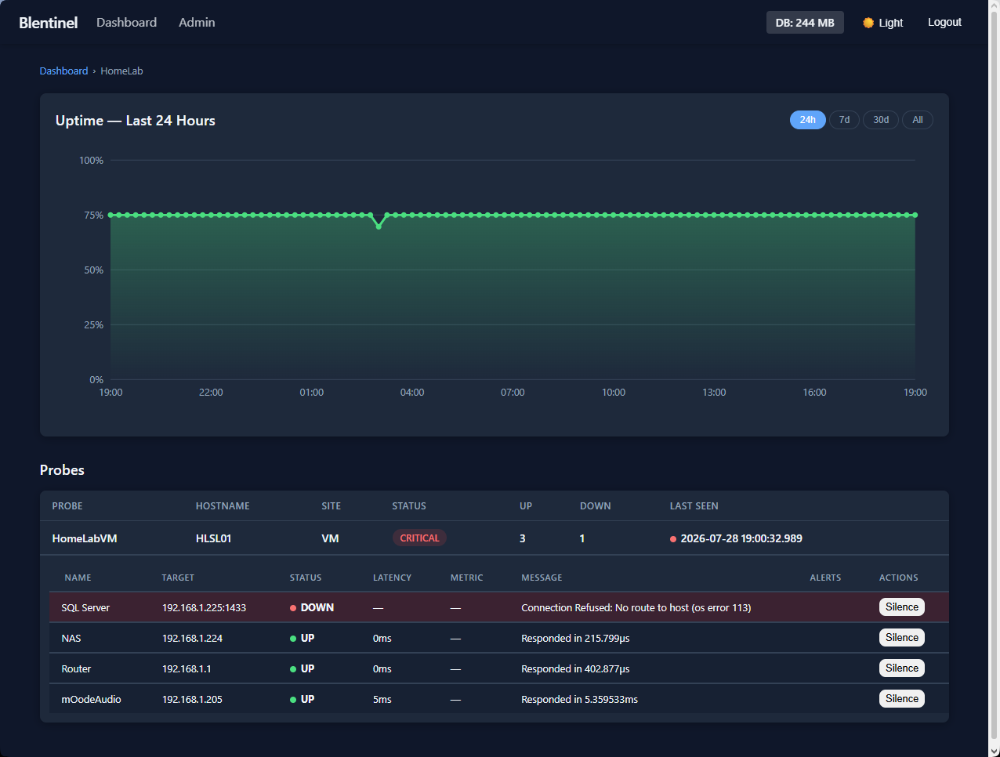

# Blentinel

**Monitoring for Managed Service Providers that works from inside any client network, without opening a single inbound port.**

Blentinel (the *Bl*ind S*entinel*) has two parts. A small **probe** runs inside each client network and checks the devices there: servers, switches, NAS, printers, web services, disks, CPU. It **pushes** signed, encrypted reports out to your central **hub**, which shows every client on one dashboard and alerts you when something breaks.



> **Status: pre-alpha.** Usable, and used in production by its author, but not stable yet. Upgrades may require resetting the hub's database. See [CHANGELOG.md](CHANGELOG.md) before upgrading.

## Why push?

Most monitoring tools reach *into* the networks they watch, so every client network needs inbound firewall rules, a VPN or a tunnel. That's more attack surface and more setup per client.

A Blentinel probe only makes **outbound** requests to the hub, the same as a browser. It works behind NAT, carrier-grade NAT and strict firewalls. The hub never connects to a probe.

## How it works

```
 client network                                     your hub
 ┌────────────────────────────┐                     ┌───────────────────────┐
 │ probe ── ping/http/tcp ──► devices               │  verify · store ·     │
 │   │  ── cpu/mem/disk ────► its own host          │  alert · dashboard    │
 │   └─ signed + encrypted report ──── HTTPS/HTTP ─►│                       │
 └────────────────────────────┘   (outbound only)   └───────────────────────┘
```

- **Probe:** one self-contained binary (Linux or Windows) with no runtime or dependencies to install, and no config file. It runs the checks the hub gives it every *N* seconds, signs each report with its own key, encrypts it for the hub, and buffers reports while the hub is unreachable.
- **Hub:** accepts reports only from enrolled probes with valid signatures, decides which company and site each probe reports for, rejects replays, stores the history, tracks which probes have gone silent, sends alerts (e-mail, webhooks, Teams, Slack, Discord, Telegram, ntfy; all optional), and serves the web dashboard.

More detail: [docs/architecture.md](docs/architecture.md) · [docs/security.md](docs/security.md)

## Features today

- **Checks:** ping (latency, packet loss, jitter; a TCP port for hosts that answer no ping), web pages over HTTP(S) (expected status codes, text that must or mustn't be there, redirects, headers), TCP port, DNS names (do they resolve, and to the right address?), TLS certificates (days until they expire, and whether a browser would accept them), files and folders (is last night's backup there, recent and big enough?), services (Windows services, systemd units), and CPU, memory, disks (one by one, or every disk the probe finds) and uptime of the probe's machine. Checks are records on the hub, sent to each probe in the hub's signed answer to its reports; nothing is edited on the client's machine
- **Dashboard:** companies sorted by severity (critical / degraded / healthy), per-probe device status, uptime history (24 h / 7 d / 30 d / all)
- **Statuses and alerts**: each result is Up, Warning or Down as the hub judges it (Unknown when its probe stops), with warning and down limits for CPU, memory, disk, response times and a certificate's days left set for the hub, each company, site or check; alerts after 2 results in a row (per check), when a probe stops reporting; channels (e-mail, signed webhooks, Teams, Slack, Discord, Telegram, ntfy on ntfy.sh or your own server) with **Send test**, and routing rules by company, site, alert and check kind, all set in the UI; incidents with a timeline, acknowledgement and notes, reminded and escalated until someone acknowledges; a daily digest e-mail; dependencies (behind a dead gateway, one alert instead of a dozen); maintenance windows (once, weekly, monthly, in the site's time zone) and silences of a check, probe, site or company
- **Security:** Ed25519-signed and X25519/ChaCha20-Poly1305-encrypted reports, enrollment with short-lived codes, replay protection, HTTPS for the web UI by default (a certificate from Let's Encrypt, renewed automatically, if you turn it on), HTTPS for probes pinned to the hub's certificate key, CSRF protection and login rate limiting
- **Resilience:** probes buffer reports for up to 7 days while the hub is down, then deliver them in order
- **Companies and sites:** added, named, given contacts and addresses, or archived in the UI; probes are added to a site with **Add probe** and a one-time code
- **Checks in the UI:** each probe's page lists its checks with their latest results; add, edit, disable or delete them, copy them from another probe, ask network devices for values over SNMP (v2c and v3, their community and passwords sealed and never shown again; whole tables, with limits on each value; ready-made for printers, switch ports, Synology and QNAP NAS and APC UPS), watch that a program runs, how many of it, and what CPU and memory it uses, see which machines have security updates waiting or need a restart (reported, never installed), ask a PostgreSQL, MySQL, MariaDB, SQL Server or MongoDB server whether it takes connections (in its own protocol, without an account), add the ones the hub suggests from what the probe's machine is made of (its disks, gateway and running services) or a template's, set the report interval, and see whether the probe runs the latest ones; **Run checks now** reaches the probe within a second or two (it keeps a request open to the hub for commands, D-76), and it checks at once and reports back
- **The fleet at a glance:** the **Probes** page lists every probe with its version, last report, uptime, reports held back, clock against the hub's, whether it runs its checks and its last problem, all from its signed reports, and flags those that need attention
- **Users:** personal accounts with roles (Owner, Admin, Technician, Viewer, Client), a first-run setup wizard; each user sees all companies, only some, or all except some, so technicians and customers get exactly their companies; an audit log of who did what
- **Probe updates:** probes update themselves from their hub once an admin approves a version, only to releases signed with your own release key (which never goes to the hub), never to an older one without a signed rollback, and go back on their own if the new version can't start or report. Canary probes get a release first; each company follows the rollout, takes none, or stays on one release, within an update window
- **Hub upgrades, never unattended:** the admin page can say when a newer signed release is out; `hub upgrade` checks it, tries it on a copy of the database, backs up, and puts the old hub and database back if the new one doesn't keep running
- **Data:** embedded SQLite (nothing to install), retention warnings and archiving

Coming next, in order: smarter alerting (Docker images later), staged probe rollouts, more check types (pending updates, processes), and reports. See the [roadmap](docs/ROADMAP.md).

## Getting started

1. **Install the hub** on a Linux server with one line: it checks the release's signature and checksums, sets the hub up as a service, and prints the address and the setup code for the first Owner. It backs itself up every day (set on the admin page) and before upgrading its database; `hub status`, `hub doctor` and `hub backup` look after it: [docs/install/hub.md](docs/install/hub.md)

   ```sh
   curl -fsSL https://github.com/mrjimmybob/blentinel/releases/latest/download/hub.sh | sudo sh
   ```

   Or build from source ([CONTRIBUTING.md](CONTRIBUTING.md#set-up)) and run `sudo ./hub install` (Windows: `.\hub.exe install`), after creating your release key once with `blentinelmake release keygen` (it signs the probe versions your probes update to: [docs/install/hub.md](docs/install/hub.md#1-build)).
2. **Add a company and site, then Add probe: the hub gives a one-line command that installs the probe in that network as a service:** [docs/install/probe.md](docs/install/probe.md)
3. Optional: **probes over HTTPS, your own certificate, or a reverse proxy:** [docs/install/https.md](docs/install/https.md)
4. Optional: **alerts on phones with ntfy**, on ntfy.sh or your own server: [docs/install/ntfy.md](docs/install/ntfy.md)

Running into problems? [docs/guide/troubleshooting.md](docs/guide/troubleshooting.md)

## Documentation

| | |
|---|---|
| **Guides** | [Users & roles](docs/guide/users.md) · [Companies & sites](docs/guide/companies-sites.md) · [Audit log](docs/guide/audit.md) · [Alerting](docs/guide/alerting.md) · [Data retention & archives](docs/guide/data-retention.md) · [Troubleshooting](docs/guide/troubleshooting.md) |
| **Reference** | [Configuration](docs/reference/configuration.md) · [Checks](docs/reference/checks.md) · [CLI](docs/reference/cli.md) · [HTTP API](docs/reference/api.md) · [Probe protocol](docs/reference/protocol.md) · [Database](docs/reference/database.md) |
| **Design** | [Architecture](docs/architecture.md) · [Security](docs/security.md) · [Principles](docs/PRINCIPLES.md) · [Decisions](docs/DECISIONS.md) · [Proposals](docs/proposals/) |
| **Project** | [Roadmap](docs/ROADMAP.md) · [Changelog](CHANGELOG.md) · [Contributing](CONTRIBUTING.md) · [Engineering standards](docs/ENGINEERING.md) |

A PDF manual can be generated from these pages (`blentinelmake docs`, see [CONTRIBUTING.md](CONTRIBUTING.md#manual)).

## Principles

Blentinel's design is bound by a few rules that don't change ([docs/PRINCIPLES.md](docs/PRINCIPLES.md)):

1. **Push only:** probes connect out; the hub never connects to a probe.
2. **Zero-dependency probe:** one static binary; everything it needs lives in its own folder.
3. **Zero trust:** every report is signed and encrypted; the hub trusts nothing a probe can't prove.
4. **Resilient:** a probe keeps working and buffering while the hub is unreachable.
5. **Easy to install and run:** embedded database, no external services; managed from the web UI (in progress).

## Contributing

Build instructions, tests and how changes are made: [CONTRIBUTING.md](CONTRIBUTING.md).

## License

[MIT](LICENSE)
